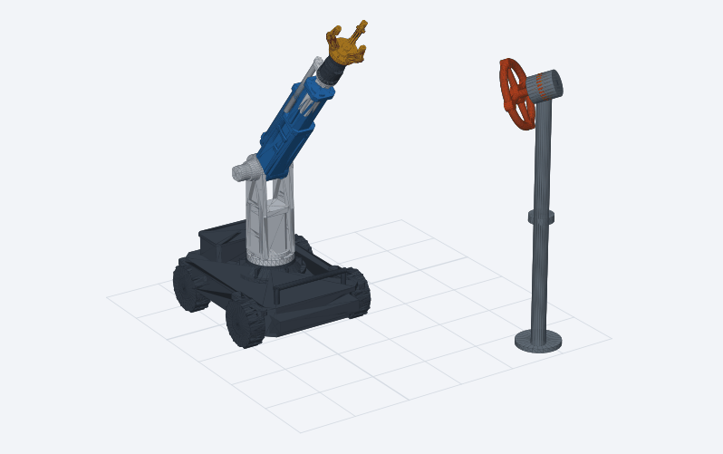
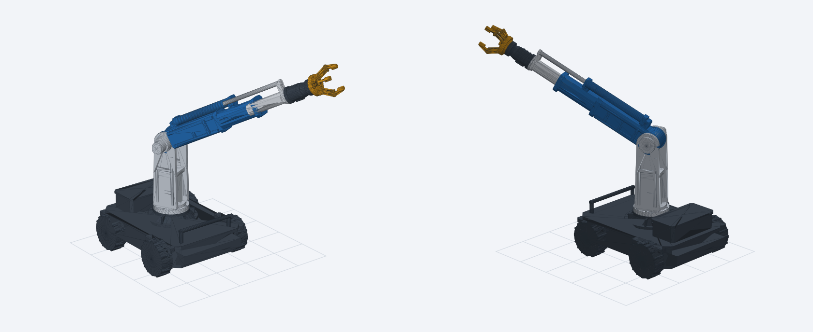
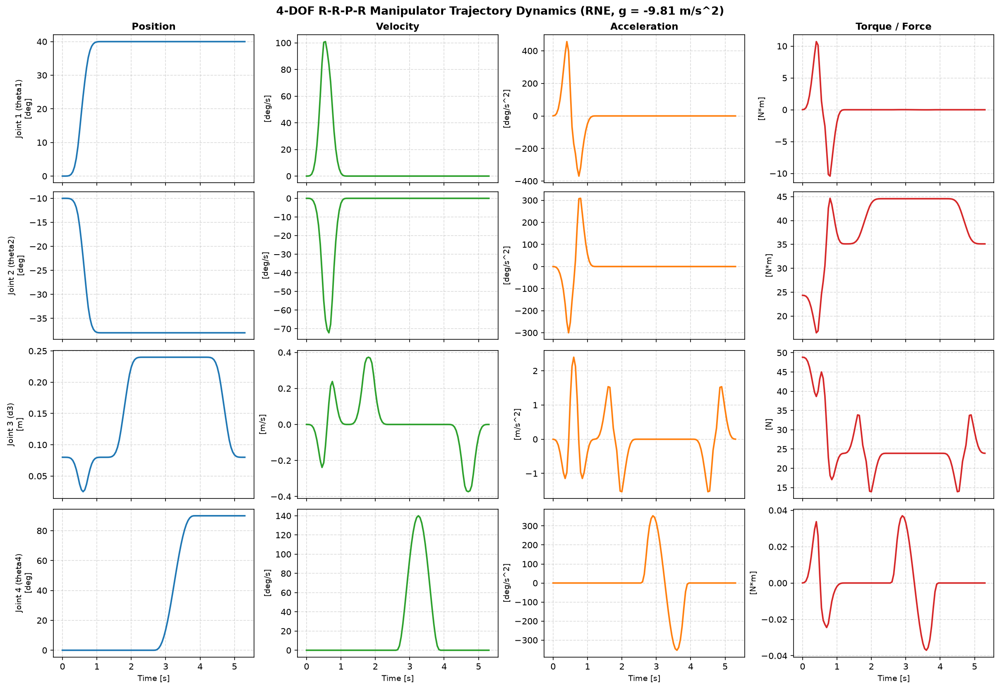

<p align="center">
  
</p>

# Manipulator Arm — 4-DOF R-R-P-R Mobile Manipulator

## Introduction

This project was developed as part of an undergraduate Robotics assignment. The objective was to design, model, and simulate a robotic manipulator with at least 3 degrees of freedom and at least one prismatic joint, mounted on a mobile platform, to solve an operational challenge faced by the oil and gas industry (**Petrobras**).

The manipulator is a **4-DOF R-R-P-R articulated arm** mounted on a 4WD mobile inspection rover, designed for **Topside Piping & Vessels — Valve Opening and Connector Coupling**.

<p align="center">
  
</p>

## Repository Structure

```text
├── assets/
│   ├── meshes/                     # 3D CAD meshes (.stl)
│   └── urdf/manipulator.urdf       # Robot URDF description with link masses and inertias
├── visualization/
│   ├── cad_overview.png            # Mechanical CAD assembly views
│   ├── trajectory.gif              # Animated 3D Cartesian valve-opening trajectory
│   └── dynamics.png                # Joint position, velocity, acceleration, and torque/force plots
└── manipulator_arm/
    ├── run_simulation.py           # Main runner for FK, IK, trajectory, and dynamics
    ├── simulation/
    │   ├── robot_description.py    # Link dimensions, masses, CoMs, inertias, and URDF loader
    │   └── sim.py                  # Robotics Toolbox simulation runner
    ├── kinematics/
    │   ├── forward_kinematics.py   # Custom Denavit-Hartenberg Forward Kinematics
    │   └── inverse_kinematics.py   # Analytical Inverse Kinematics and Geometric Jacobian
    ├── trajectory/
    │   ├── joint_trajectory.py     # 5th-order polynomial trajectory interpolation
    │   ├── workspace_trajectory.py # Cartesian workspace interpolation
    │   └── traj_planner.py         # 5-phase valve trajectory planner and GIF renderer
    └── dynamics/
        └── inverse_dynamics.py     # Recursive Newton-Euler (RNE) inverse dynamics and plots
```

## Installation

Using [`uv`](https://docs.astral.sh/uv/):

```bash
uv sync
```

Or using `pip`:

```bash
pip install -e .
```

## Running the Project

### 1. Forward Kinematics (`fk`)

Pass joint values `[theta1_deg, theta2_deg, d3_m, theta4_deg]` (or run without `--q` to type them interactively in the terminal):

```bash
uv run python manipulator_arm/run_simulation.py fk --q 40 -38 0.15 30
```

### 2. Inverse Kinematics (`ik`)

Pass target coordinates `[x_m, y_m, z_m]` (or run without `--xyz` to type them interactively in the terminal):

```bash
uv run python manipulator_arm/run_simulation.py ik --xyz 0.6392 0.5364 0.7371 --theta4 30
```

### 3. Cartesian Trajectory (`trajectory`)

Run the 5-phase Cartesian valve-opening trajectory (`Align -> Extend -> Grasp -> Turn 90° -> Release & Retract`) in Robotics Toolbox (`--backend pyplot` or `--backend swift`):

```bash
uv run python manipulator_arm/run_simulation.py trajectory --backend pyplot
```

### 4. Inverse Dynamics (`dynamics`)

Compute joint torques and forces along the trajectory using Recursive Newton-Euler (RNE) and plot position, velocity, acceleration, and effort for each joint:

```bash
uv run python manipulator_arm/run_simulation.py dynamics --show
```

<p align="center">
  
</p>
